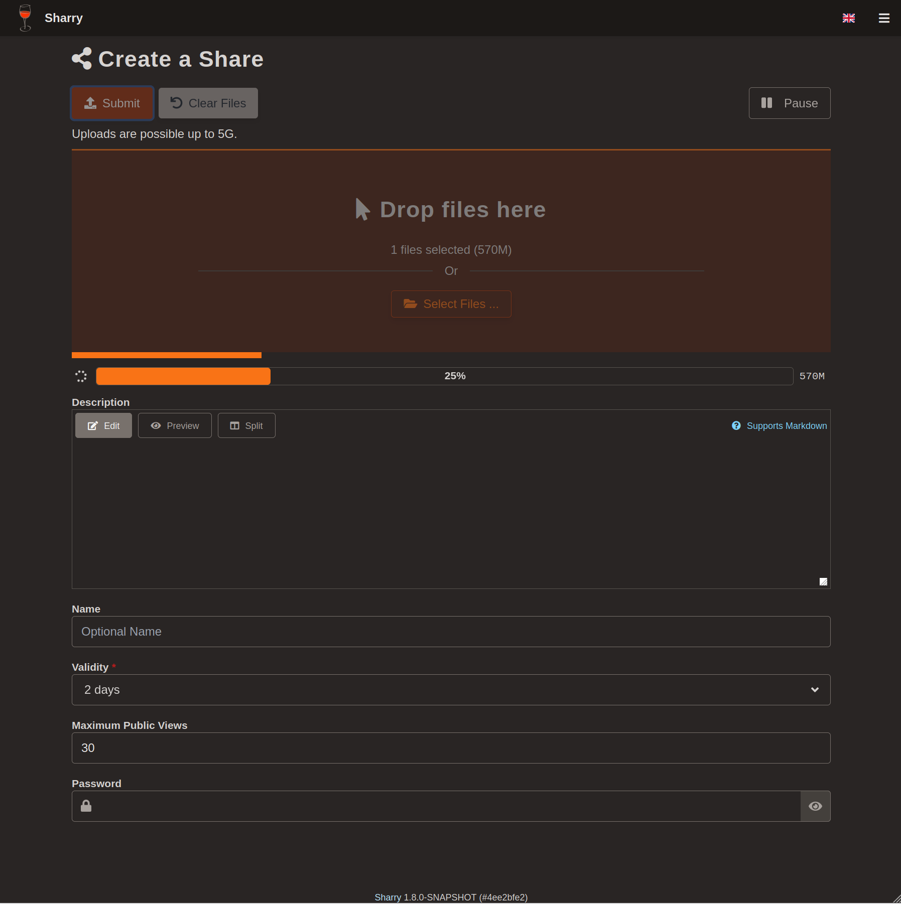

# Sharry

Sharry is a self-hosted file sharing web app — upload files and get a shareable link back, with an optional password, a validity period, and a download limit. People without an account can also send files to you through alias pages. Deploy it on Railway and your shares live in your own database and volume, not a third-party file host.

*Sharry upload UI — upstream screenshot from the Sharry project documentation (eikek/sharry, GPL-3.0), showing the share form with drag-and-drop upload, validity, view limit, and password.*

## Source Repository

[https://github.com/INAPP-Mobile/sharry](https://github.com/INAPP-Mobile/sharry)

## Deploy and Host

One-click deploy creates a single Sharry service with a persistent volume. No companion database is needed: Sharry stores accounts, shares, and file contents in an embedded H2 database file on the volume. On first boot the wrapper maps Railway's injected `PORT` onto Sharry's bind port, derives the public base URL from Railway's domain, and enables the fixed admin account with the generated deploy variables.

After deploy, open the public URL and sign in as `admin` with the generated `ADMIN_PASSWORD` (find it in your Railway project's variables). Registration is closed by design — only the admin account can sign in — so a public URL is not an open upload service. The admin can create additional accounts and invite keys from inside Sharry.

## Why Deploy

- Share files with a link, a password, an expiry date, and a maximum number of views — no account needed to download.
- Alias pages let anyone send files to you without you sharing an upload login.
- Resumable uploads (TUS protocol) with chunking, pause, and retry — large files survive flaky connections.
- Shares up to 1.5 GB each by upstream default, with Markdown descriptions and ZIP download of a whole share.
- No database service to run: one always-on JVM service with an embedded database file on a persistent volume.
- Self-hosted data: your files stay on your Railway volume.

## Common Use Cases

- Send a large file or folder to a client without a WeTransfer-style third party holding it.
- Collect files from many people through one alias link (event photos, homework, field reports).
- Share a time-limited download (a build, a video, a press kit) that stops working on its own.
- Run a private drop-box for a team, a classroom, or a family.

## Configuration

Only two variables appear on the deploy form, and both are generated:

| Variable | Default | Description |
| --- | --- | --- |
| `ADMIN_PASSWORD` | `${{secret(16)}}` | Password for the `admin` account (fixed-auth admin, created on first login). Generated on deploy; changing it later does not change the password — change it in the Sharry UI instead. |
| `SERVER_SECRET` | `${{secret(32)}}` | Secret used to sign Sharry auth tokens. Generated on deploy; it must stay unique per deployment because the upstream default is public in the Sharry repo, so never leave it unset. |

Everything else is baked into the image. Applicable upstream variables and their baked values:

| Variable | Value | Description |
| --- | --- | --- |
| `PORT` | Railway-injected | Sharry's bind port: the wrapper exports it as `SHARRY_BIND_PORT` on every boot (upstream default is 9090). |
| `RAILWAY_PUBLIC_DOMAIN` | Railway-generated | The wrapper derives `SHARRY_BASE_URL` (`https://{domain}`) from it on every boot; share links, cookies, and websockets are built from it. |
| `SHARRY_BACKEND_JDBC_URL` | `jdbc:h2:/data/sharry;MODE=PostgreSQL;DATABASE_TO_LOWER=TRUE` | Embedded H2 file database on the volume, in PostgreSQL compatibility mode (upstream's own default backend). No Postgres/MariaDB service needed. |
| `SHARRY_BACKEND_AUTH_FIXED_ENABLED` / `USER` | `true` / `admin` | Fixed-auth module on; the fixed user is created as an admin on first login (upstream behavior). |
| `SHARRY_BACKEND_SIGNUP_MODE` | `closed` | Open registration is off; upstream's shipped default is `open`, which would turn a public URL into an open upload service. |
| `SHARRY_BACKEND_AUTH_INTERNAL_ENABLED` | `true` | Internal (database) auth for accounts created in the UI, alongside fixed auth. |
| `SHARRY_BACKEND_FILES_DEFAULT_STORE` | `database` (upstream default) | File contents are stored as BLOBs in the H2 database, so one volume holds everything. The filesystem and S3 stores are upstream options not wired in this template. |
| `SHARRY_BACKEND_SHARE_MAX_SIZE` | `1.5G` (upstream default) | Maximum size of one share. |
| `SHARRY_BACKEND_SHARE_MAX_VALIDITY` | `365 days` (upstream default) | Maximum validity of a share. |
| `SHARRY_BACKEND_MAIL_ENABLED` | `false` (upstream default) | Email notifications off; SMTP is an upstream option not wired in this template. |
| `JAVA_OPTS` | `-Xmx512m` | JVM heap cap: the launcher honours `JAVA_OPTS`, and the JVM would otherwise size its heap from host memory instead of the container limit. |

## Persistence

One volume mounted at `/data` holds the H2 database file (`/data/sharry.mv.db`), which contains accounts, shares, and file contents. Restarts and redeploys keep everything. Back up the volume to back up Sharry.

## Deployment Dependencies

- Plan tier: works on Railway's entry tiers; a single always-on service with a 5 GB volume.
- RAM needs: modest — one JVM service capped at a 512 MB heap, no companion database or cache service.
- Upstream: [Sharry v1.17.0](https://github.com/eikek/sharry) (GPL-3.0), image pinned by manifest digest.
