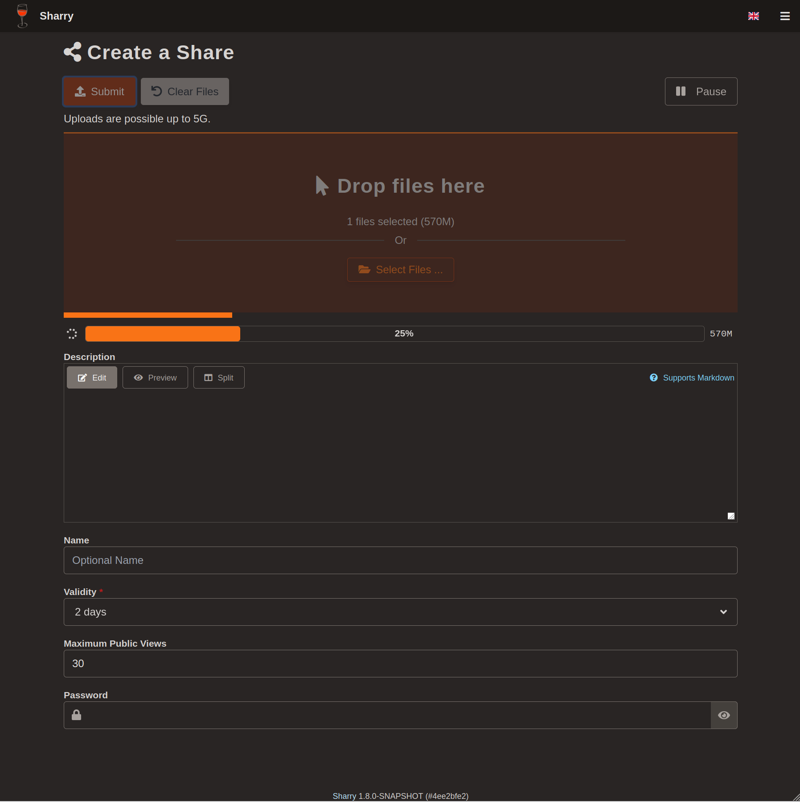

*Sharry upload UI — upstream screenshot from the Sharry project documentation (eikek/sharry, GPL-3.0).*

# Deploy and Host

Sharry is a self-hosted file sharing web app: upload files and get a shareable link back, with an optional password, a validity period, and a download limit — and alias pages that let anyone send files to you. One-click deploy creates a single Sharry service with a persistent volume and no companion database: accounts, shares, and file contents live in an embedded H2 database file on the volume. After deploy, sign in as `admin` with the generated password from your project's variables; registration is closed by design, so a public URL is not an open upload service.

## About Hosting

Hosting Sharry on Railway keeps your shared files on your own volume instead of a third-party file host. The deployment is a single always-on JVM service: the wrapper maps Railway's injected `PORT` onto Sharry's bind port, derives the public base URL from Railway's domain on every boot, enables the fixed admin account with generated credentials, closes open registration, and caps the JVM heap at 512 MB. The only deploy-form fields are the two generated secrets.

## Why Deploy

- Share files with a link, a password, an expiry date, and a maximum number of views — no account needed to download.
- Alias pages let anyone send files to you without you sharing an upload login.
- Resumable uploads (TUS protocol) with chunking, pause, and retry — large files survive flaky connections.
- Shares up to 1.5 GB each by upstream default, with Markdown descriptions and ZIP download of a whole share.
- No database service to run: one always-on service with an embedded database file on a persistent volume.
- Self-hosted data: your files stay on your Railway volume.

## Common Use Cases

- Send a large file or folder to a client without a WeTransfer-style third party holding it.
- Collect files from many people through one alias link (event photos, homework, field reports).
- Share a time-limited download (a build, a video, a press kit) that stops working on its own.
- Run a private drop-box for a team, a classroom, or a family.

## Dependencies for

- A single Sharry service (Scala/JVM, embedded H2 database, no companion service).
- One persistent volume mounted at `/data` (H2 database file with accounts, shares, and file contents).
- Environment variables (condensed reference — full documentation in the repo README):

| Variable | Default | Description |
| --- | --- | --- |
| `ADMIN_PASSWORD` | generated | Password for the `admin` account (fixed-auth admin, created on first login); the only login credential. |
| `SERVER_SECRET` | generated | Secret used to sign auth tokens; must stay unique per deployment. |
| `PORT` | Railway-injected | Sharry's bind port, mapped by the wrapper on every boot. |
| `SHARRY_BACKEND_JDBC_URL` | `jdbc:h2:/data/sharry;MODE=PostgreSQL;DATABASE_TO_LOWER=TRUE` | Embedded H2 file database on the volume (upstream's own default backend). |
| `SHARRY_BACKEND_SIGNUP_MODE` | `closed` | Open registration off; upstream's shipped default is `open`. |
| `JAVA_OPTS` | `-Xmx512m` | JVM heap cap. |

### Deployment Dependencies

- Plan tier: works on Railway's entry tiers; a single always-on service with a 5 GB volume.
- RAM needs: modest — one JVM service capped at a 512 MB heap, no companion database or cache service.
